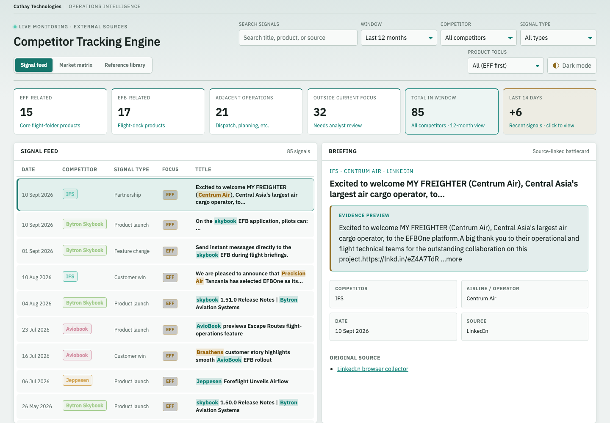
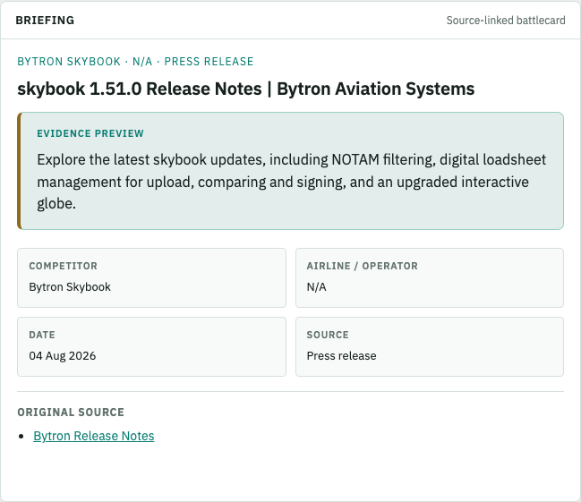
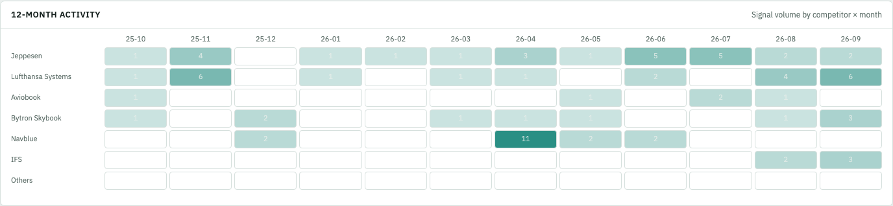
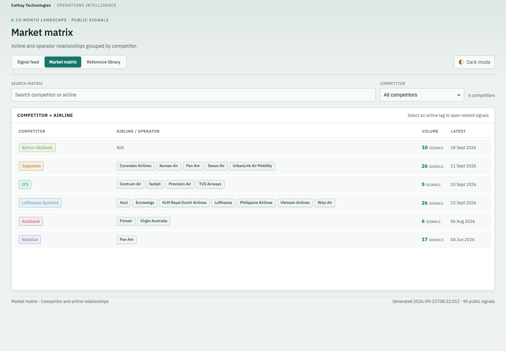
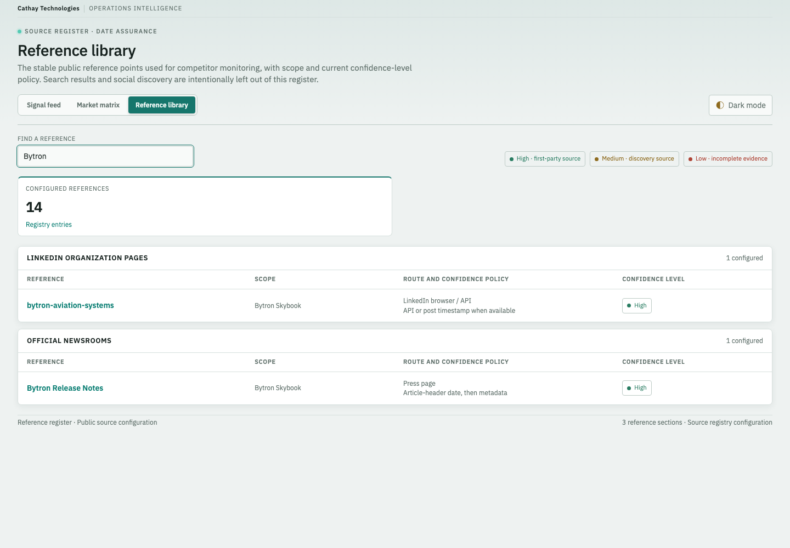

# Competitor Tracking Engine — Simple User Guide

**Draft · 24 September 2026 · Cathay Technologies**

Use this tool to review public competitor updates, explore airline/operator mentions, and check the sources behind your findings. A **signal** is a captured update, such as a product launch, feature change, partnership, or customer win.

Screenshots show the current saved dataset in **light mode**. Your counts and results may differ after a data refresh. Click any screenshot to view it at full size.

## 1. Open the tool

Open the dashboard address provided by the tool owner. For local use, the owner can start the dashboard with [start.sh](../start.sh), which requires Python 3, then open <http://127.0.0.1:8765/>. Keep the server running while using the tool; do not open the HTML files directly.

Use the navigation tabs to switch views:

| View | Use it to… |
| --- | --- |
| **Signal feed** | Find updates and read their supporting evidence. |
| **Market matrix** | Explore competitor and airline/operator mentions. |
| **Reference library** | See configured monitoring sources and confidence policies. |

Select **Light mode** or **Dark mode** to change appearance. Your choice is remembered across views.

## 2. Find an update in the Signal feed

*Figure 1. Navigation is at the top left, filters at the top right, and summary cards above the feed and briefing.*

1. Open **Signal feed**.
2. Set **Window**, for example **Last 14 days** for recent activity or **Last 12 months** for a wider view.
3. Choose a **Competitor**, or leave **All competitors** selected.
4. Optionally choose a **Signal type** and **Product focus**.
5. Enter a keyword in **Search signals**, such as **skybook**. Results update as you type; no submit button is needed.
6. Click a result to open its **Briefing**. On narrower screens, scroll down to find the briefing.

All filters work together. **Clear** removes only the search text—not the other filters.

### Understand product focus

| Focus | Meaning |
| --- | --- |
| **EFF** | Electronic Flight Folder / core flight-folder products. |
| **EFB** | Electronic Flight Bag / flight-deck products. |
| **Adjacent operations** | Related areas such as dispatch and flight planning. |
| **Outside current focus** | Other updates that may need analyst review. |

The default **All (EFF first)** view groups EFF first, followed by EFB, adjacent operations, and other updates. Dates run newest first **within each group**, not across the entire feed.

**Quick shortcuts:** Click **Last 14 days** in the summary cards for recent updates, or a focus card such as **EFF-related** to narrow the feed. Focus-card shortcuts also reset the window to 12 months.

> **Count tip:** Use the count beside **Signal feed** for the number of displayed results. Most summary cards use a 12-month view and ignore the selected product focus, so their counts can differ from the feed—even the card labelled **Total in window**.

## 3. Read and verify a briefing

*Figure 2. Example: search for **1.51.0**, then select the skybook release-note result.*

1. Read the headline and **Evidence preview**.
2. Check **Competitor**, **Airline / operator**, **Date**, and **Source**.
3. Click a link under **Original source** to open the supporting page in a new tab.
4. Verify the original wording, date, and context before sharing a finding.

**N/A** means no operator was recognized; it does not prove that no airline is involved. Previews can be incomplete, and some external sites may require sign-in.

### Check activity over time

*Figure 3. Scroll below the feed to see **12-month activity**.*

Each cell shows signal volume for one competitor and month. Stronger shading indicates more activity. Hover over a cell for its count. The chart reflects the filtered feed; cells are not clickable drill-down links.

## 4. Explore the Market matrix

*Figure 4. Airline tags and competitor names are clickable.*

1. Open **Market matrix**.
2. Use **Search matrix** to find a competitor or airline, or select a **Competitor**.
3. Read **Volume** as the competitor's total signal count and **Latest** as its most recent signal date.
4. Click an **airline tag** to open related signals in the Signal feed. Alternatively, click a **competitor name** to open that competitor's feed.
5. To leave an airline drill-down and restore the normal feed, click the **Signal feed** navigation tab. **Clear** alone does not remove the drill-down restriction.

**Keep in mind:**
- Airline names are inferred from captured text—not a verified customer list.
- Search keeps whole competitor rows, including their other airline tags.
- The matrix uses all loaded signals, so its totals can differ from the date-filtered feed.
- Airline drill-down keeps one signal per date, so it may show fewer results than expected.

## 5. Check the Reference library

*Figure 5. Example: enter **Bytron** in **Find a reference**.*

1. Open **Reference library**.
2. Search by competitor, source name, or URL.
3. Review matching entries under **RSS feeds**, **LinkedIn organization pages**, or **Official newsrooms**.
4. Read **Scope**, **Route and confidence policy**, and **Confidence level**.
5. Click a linked reference name to open its site in a new tab. Delete the search text to restore the full list.

The legend defines **High** as first-party, **Medium** as discovery, and **Low** as incomplete evidence. These are source-policy labels, not a guarantee that every captured claim is correct. **Configured references** remains the full registry count while searching.

## 6. Quick help

| If you see… | Try this |
| --- | --- |
| No matching signals | Clear search, widen **Window**, and restore **All competitors**, **All types**, and **All (EFF first)**. |
| Only a few signals after using the matrix | Click the **Signal feed** navigation tab to leave the airline drill-down. |
| Old or missing updates | Check the footer's **Generated** timestamp and contact the tool owner about the next capture. |
| A blank page or loading error | Check that the local server is running and open the HTTP address rather than an HTML file. |
| An incomplete preview or unavailable source | Try another listed source and verify externally before relying on the update. |

> **Data freshness:** The dashboard displays saved captures. Reloading reads the latest saved data; it does **not** collect new updates. Data capture is a separate maintenance task handled by the tool owner.

**Suggested routine:** Review **Last 14 days** → narrow by competitor or focus → read the briefing → verify the original source → explore relevant airline mentions in the matrix.